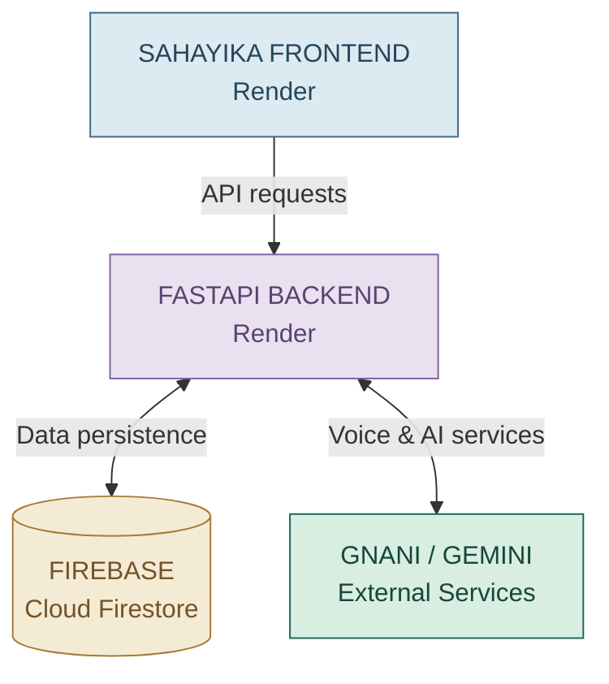

<div align="center">

# SAHAYIKA

### One ASHA worker. An entire community to look after.

**A digital companion for India's frontline community healthcare workers.**

<br/>

[**LIVE APPLICATION ↗**](https://sahayika-frontend.onrender.com/) · [**BACKEND API ↗**](https://sahayika-backend.onrender.com/) · [**SOURCE CODE ↗**](https://github.com/ansm32004/ASHA-GNANI)

<br/>

<div align="center">

<table>
<tr>
<td align="center" width="160">
<br/>
<b>React Native</b><br/>
<sub>Mobile experience</sub>
</td>
<td align="center" width="160">
<br/>
<b>FastAPI</b><br/>
<sub>Backend engine</sub>
</td>
<td align="center" width="160">
<br/>
<b>Firebase</b><br/>
<sub>Cloud infrastructure</sub>
</td>
<td align="center" width="160">
<br/>
<b>Expo</b><br/>
<sub>App development</sub>
</td>
</tr>
</table>

</div>

</div>

---

## The vision

ASHA workers are the bridge between communities and India's public healthcare system. Their days involve household visits, follow-ups, community support and administrative responsibilities.

Sahayika brings essential digital workflows together in one place — helping organise field work and making technology more accessible through voice-enabled assistance.

**Not another healthcare dashboard. A digital companion for the people who care for communities.**

---

## Inside Sahayika

<div align="center">

**FOUR CAPABILITIES · ONE CONNECTED EXPERIENCE**

<table>
<tr>
<td width="50%" valign="top" bgcolor="#DDECE1">

<h2>01 / ASHA WORKSPACE</h2>

### 🩺 Field operations

A dedicated workspace for everyday ASHA activities.


**⌂** &nbsp; Household management

**↗** &nbsp; Visits & follow-ups

**☑** &nbsp; Task organisation

**▤** &nbsp; Claim submission

</td>
<td width="50%" valign="top" bgcolor="#DFEAF1">

<h2>02 / COMMUNITY</h2>

### 🏡 Community experience

A separate experience designed for community users.


**◉** &nbsp; Dedicated user access

**↗** &nbsp; Role-aware navigation

**◇** &nbsp; Simplified interaction

**⌂** &nbsp; Community-oriented flow

</td>
</tr>
<tr>
<td width="50%" valign="top" bgcolor="#F2EAD9">

<h2>03 / VOICE INTELLIGENCE</h2>

### 🎙 Speech & AI

Voice-enabled capabilities for more natural interaction.


**♫** &nbsp; GNANI integration

**◉** &nbsp; Speech services

**✧** &nbsp; Gemini integration

</td>
<td width="50%" valign="top" bgcolor="#EAE2F0">

<h2>04 / CONNECTED SUPPORT</h2>

### 🛡 Cloud & support

Connected services supporting application workflows.


**◈** &nbsp; Firebase / Firestore

**⚑** &nbsp; SOS event workflows

**♧** &nbsp; Notification-related services

</td>
</tr>
</table>

</div>

---

## ◈ System workflow

*From community interaction to intelligent services — one connected architecture.*

<p align="center">
  
</p>

<p align="center">
  <sub>FIG 01 — SAHAYIKA SYSTEM WORKFLOW</sub>
</p>

## ◈ Repository map

```text
ASHA-GNANI/
│
├── backend/                  # FastAPI backend
│
├── frontend/                 # React Native + Expo
│
├── firebase.json             # Firebase configuration
├── firestore.rules           # Firestore security
├── firestore.indexes.json    # Firestore indexes
├── storage.rules             # Storage rules
│
└── SAHAYIKA_BACKEND_READINESS_AUDIT.md
```

---

## ◈ Run locally

**01 — Clone the repository**

```bash
git clone https://github.com/ansm32004/ASHA-GNANI.git
cd ASHA-GNANI
```

**02 — Set up the backend**

```bash
cd backend
python -m venv .venv
source .venv/bin/activate
pip install -r requirements.txt
```

Configure the required backend environment variables and start the FastAPI application using the entry point configured in your project.

**03 — Set up the frontend**

```bash
cd frontend
npm install
npx expo start
```

Configure the frontend API URL to point to your backend.

**04 — Configure Firebase**

Configure Firebase credentials securely for the client and backend. Review Firestore rules and indexes before deploying.

Never commit `.env` files, private keys or service-account credentials.

---

## ◈ Deployment architecture



### Live services

| SERVICE | DESTINATION |
|:--|:--|
| **Frontend** | [sahayika-frontend.onrender.com](https://sahayika-frontend.onrender.com/) |
| **Backend** | [sahayika-backend.onrender.com](https://sahayika-backend.onrender.com/) |
| **Source code** | [ASHA-GNANI on GitHub](https://github.com/ansm32004/ASHA-GNANI) |

---

## ◈ Built with responsibility

- Protect user data and keep credentials out of source control.
- Use backend validation and database security rules.
- Treat AI-generated content as assistance, not clinical judgement.
- Keep healthcare professionals and official systems at the centre of care.

---

## ◈ The bigger picture

Sahayika is inspired by the role of ASHA workers in India's community-health ecosystem.

- [National Health Mission — ASHA Guidelines](https://nhm.gov.in/images/pdf/communitisation/task-group-reports/guidelines-on-asha.pdf)
- [National Health Mission — ASHA Programme](https://www.nhm.gov.in/index1.php?lang=1&level=2&lid=249&sublinkid=176)

---

<div align="center">

### Technology should support the hands that serve communities.

**SAHAYIKA · Built for community healthcare.**

[**OPEN LIVE PROJECT ↗**](https://sahayika-frontend.onrender.com/)

</div>
